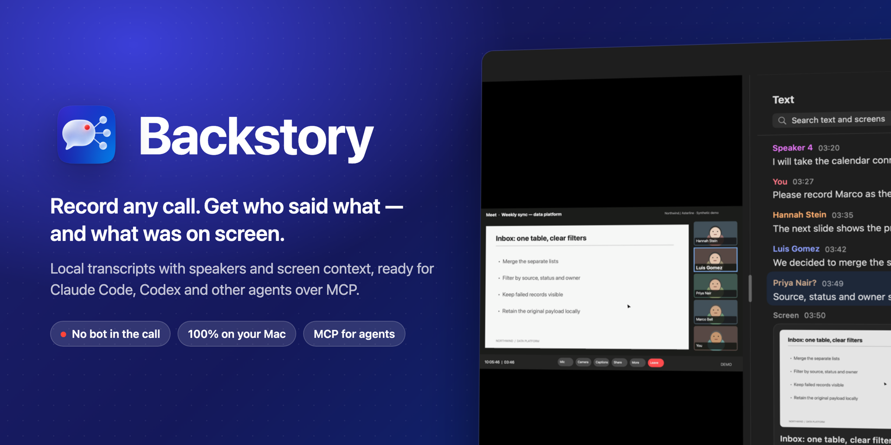
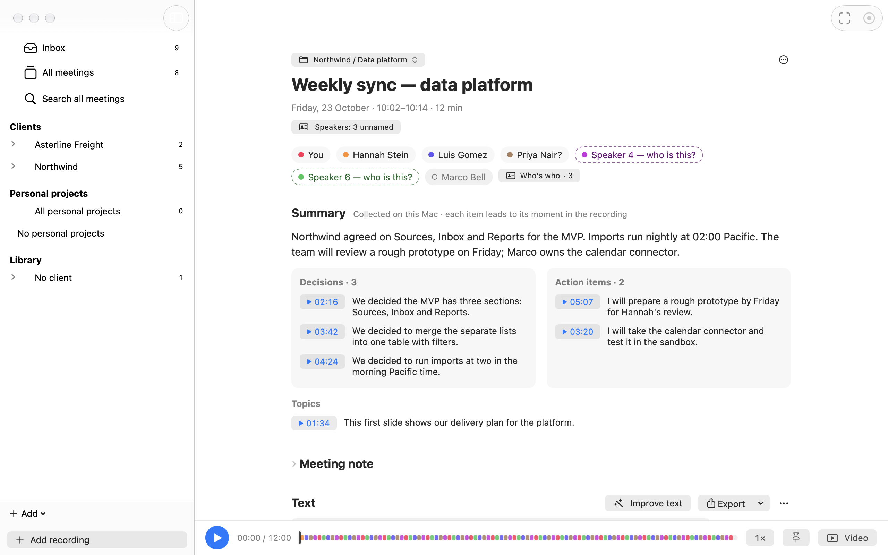
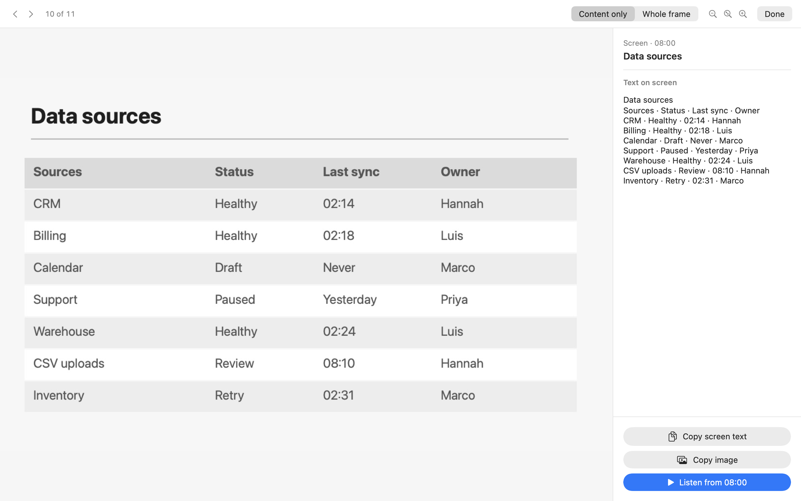
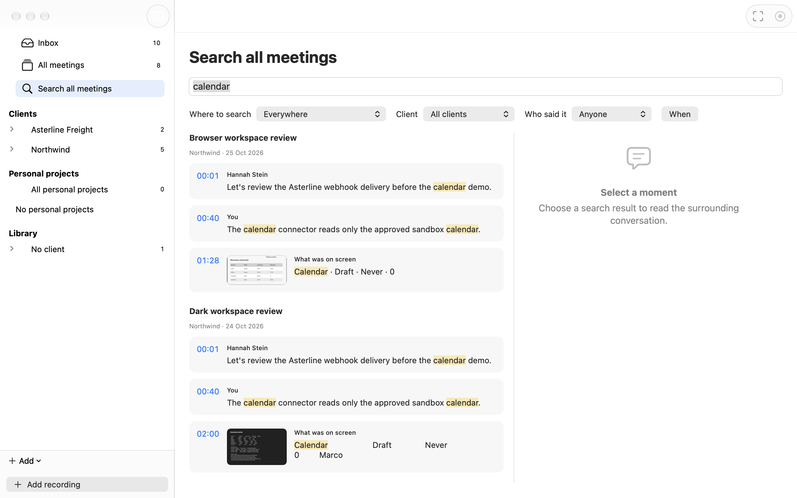
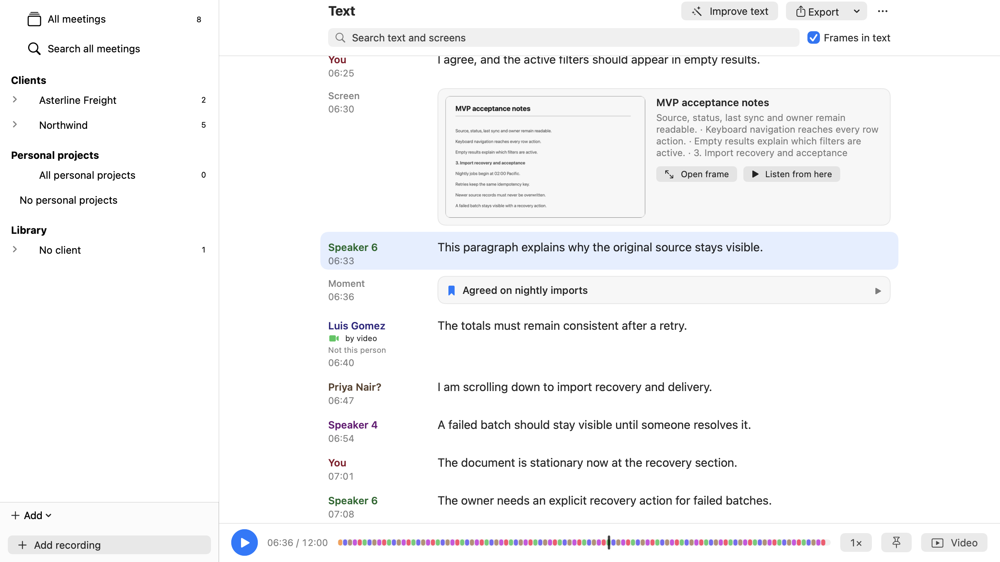
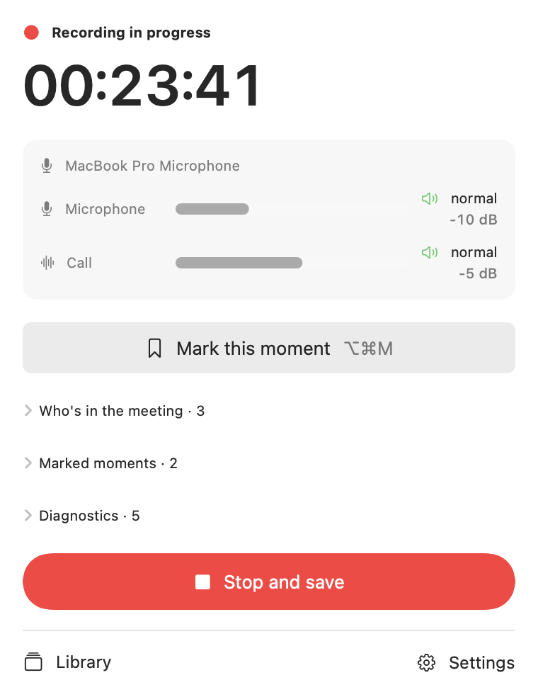
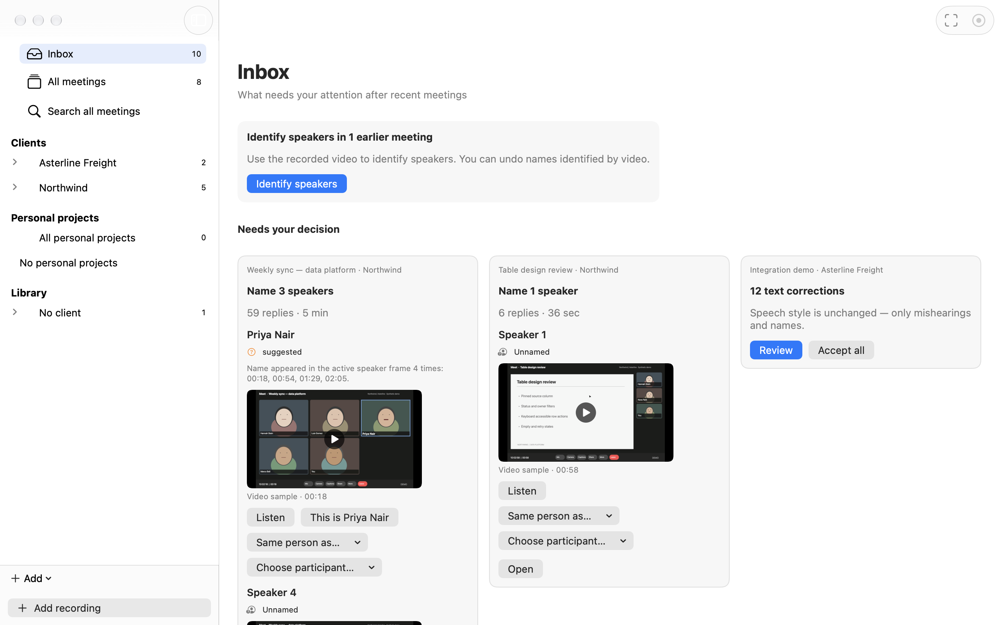
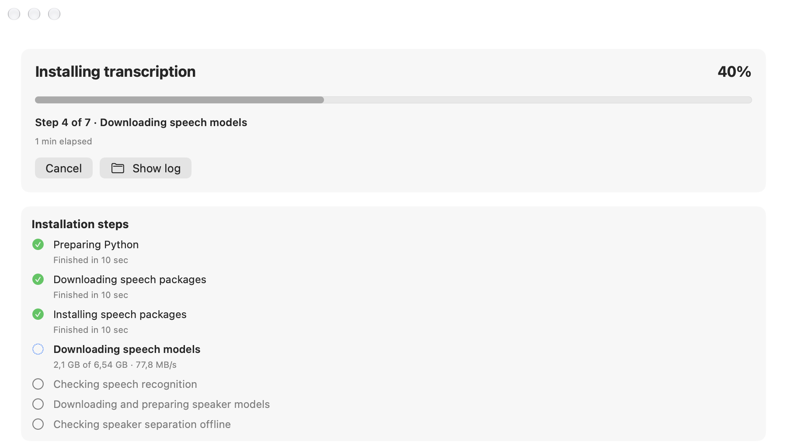
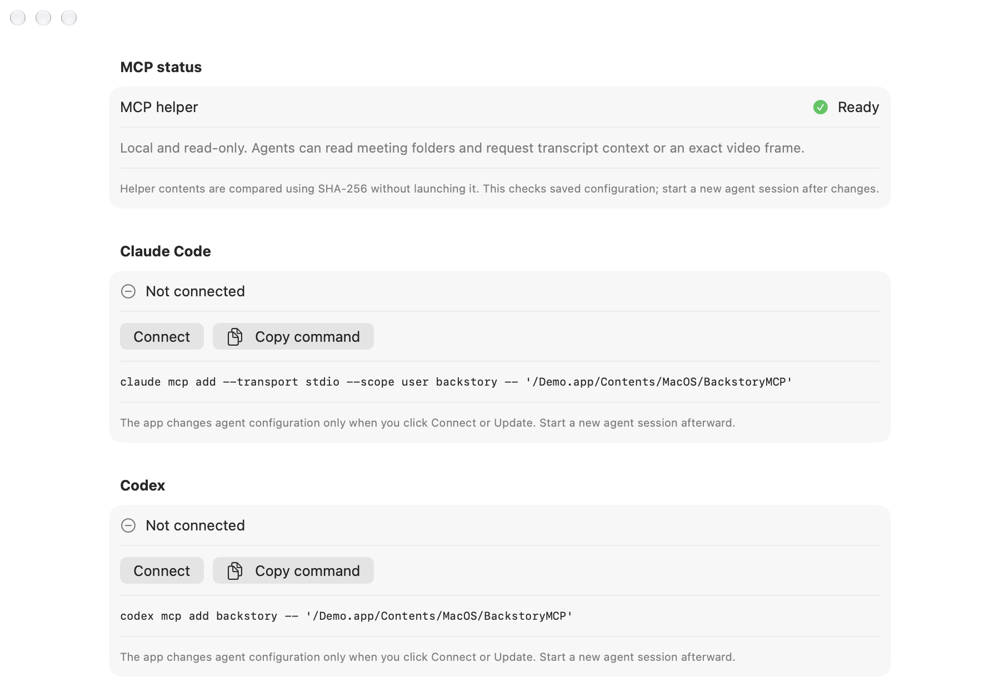
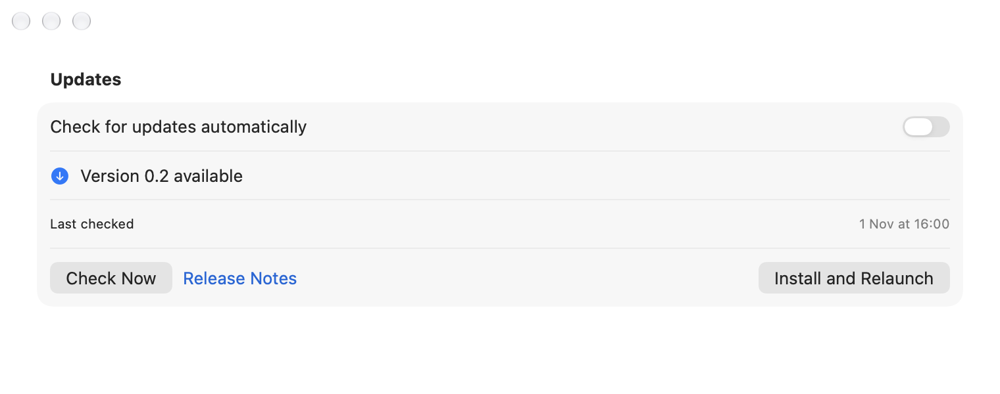

# Backstory

Local meeting recording and transcription for macOS, with MCP access for your agents.


[](https://github.com/r00tbear/Backstory-releases/releases/latest)

[](https://github.com/r00tbear/Backstory-releases/releases/latest)

Backstory records the call window you choose: Google Meet, Zoom, Teams, or another window. You start recording explicitly. Meeting audio and your microphone are saved as separate tracks alongside video in one `.mov` file. After recording, local transcription adds timestamps and speakers.

No bot joins the call. No cloud transcription or Backstory account is required. Claude Code, Codex, and other MCP clients can read saved meetings through a local, read-only helper.

This repository contains release downloads, documentation, and screenshots. The application source is private.

## What you can do

### Recording

- Choose a window or application and a microphone, then start recording.
- Watch call and microphone levels in the menu-bar popover; stop and save from there.
- Mark moments during a call so you can return to them later.
- Keep recording even when transcription runtimes are not installed.

### Transcription and speakers

- Transcribe locally with Qwen3-ASR and separate call voices with FluidAudio speaker detection.
- Read timestamped speech beside the video or below it; jump from text to the recording.
- Listen to speaker samples and confirm names in **Who's who**. When a Meet or Zoom speaker tile consistently shows the same readable name across the meeting, Backstory can confirm it **by video**; choose **Not this person** to undo it. Confirmed names appear in exports and MCP responses; ordinary suggestions do not.
- Edit text yourself, or explicitly send it to an installed Codex CLI with **Improve text** and review the proposed corrections. Optional Canary transcription provides a second recognizer's opinion.

### Screen and moments

- See extracted screen frames alongside the transcript, with locally recognized screen text.
- Open a frame, inspect its content or the whole frame, copy its image or text, and listen from that moment.
- Save a frame from the current playback position and return to marked moments.

### Library

- Use **Inbox** to review speaker names, text corrections, new summaries, and processing progress. You can also identify speakers from video in earlier meetings there.
- Organize meetings by client and project, including personal projects. Add a meeting note to any meeting.
- Search what was said, what was on screen, and summaries, decisions and action items; filter by client, speaker, and date.
- Import existing `.mov`, `.mp4`, `.m4a`, `.wav`, or `.mp3` recordings with a single audio track.
- Generate local summaries, decisions, topics, and action items when Ollama and its required model are installed. See [setup](#transcription-setup).

### Export

Export the transcript as Markdown or SRT subtitles, or copy timestamped plain text. Create an MP4 copy of a supported video recording while keeping the original `.mov`.

### Agents through MCP

The bundled helper uses `stdio`. Its six tools are read-only:

| Tool | What it does |
| --- | --- |
| `resolve_meeting` | Resolve a meeting ID or `lmr://` link to its local directory and file manifest. |
| `get_outline` | Read the current summary, decisions, topics, action items, frames, note, participants, and bookmarks. |
| `search_meeting` | Find text in one meeting's transcript and recognized screen text. |
| `search_library` | Search across meeting titles, transcripts, screen text, summaries, decisions, and action items. |
| `get_context_at` | Read transcript segments and current context frames around a time, range, or segment. |
| `get_frame_at` | Extract an exact video frame as JPEG, with an optional crop. |

Transcript tools include correction status and confirmed speaker names. Agents can retrieve context without modifying the meeting library.

## Screenshots

All names, conversations, and screens below are synthetic demo data. Images switch between light and dark appearance with your preferred color scheme. Update versions and connection states are illustrative.

**Meeting summary, speakers, and playback**

<picture>
  <source media="(prefers-color-scheme: dark)" srcset="assets/screenshots/meeting-dark.png">
  
</picture>

**Every screen frame, with the text recognized on it**

<picture>
  <source media="(prefers-color-scheme: dark)" srcset="assets/screenshots/screen-text-dark.png">
  
</picture>

**Search what was said and what was shown, across all meetings**

<picture>
  <source media="(prefers-color-scheme: dark)" srcset="assets/screenshots/search-dark.png">
  
</picture>

<details>
<summary>Screen moments and bookmarks in the transcript</summary>

<picture>
  <source media="(prefers-color-scheme: dark)" srcset="assets/screenshots/moments-dark.png">
  
</picture>

</details>

<details>
<summary>The menu-bar controls during recording</summary>

<picture>
  <source media="(prefers-color-scheme: dark)" srcset="assets/screenshots/recording-dark.png">
  
</picture>

</details>

<details>
<summary>Inbox speaker and correction review</summary>

<picture>
  <source media="(prefers-color-scheme: dark)" srcset="assets/screenshots/inbox-dark.png">
  
</picture>

</details>

<details>
<summary>Settings → Transcription during installation</summary>

<picture>
  <source media="(prefers-color-scheme: dark)" srcset="assets/screenshots/transcription-setup-dark.png">
  
</picture>

</details>

<details>
<summary>Settings → Agent access</summary>

<picture>
  <source media="(prefers-color-scheme: dark)" srcset="assets/screenshots/agent-access-dark.png">
  
</picture>

</details>

<details>
<summary>Settings → General → Updates</summary>

<picture>
  <source media="(prefers-color-scheme: dark)" srcset="assets/screenshots/updates-dark.png">
  
</picture>

</details>

## Install

1. [Download the latest release](https://github.com/r00tbear/Backstory-releases/releases/latest) and open the DMG.
2. Drag **Backstory.app** to **Applications**.
3. Open Backstory.
4. Open **Settings → Transcription** and choose **Install transcription**.

**Backstory is not notarized.** macOS will block the first launch. After trying to open it, go to **System Settings → Privacy & Security**, scroll to the security message, and choose **Open Anyway**. Confirm **Open** when prompted. This creates a one-time exception for that copy of the app; subsequent launches open normally. See [Apple's instructions](https://support.apple.com/en-us/102445).

Grant these permissions in **System Settings → Privacy & Security**:

| Permission | Why Backstory needs it |
| --- | --- |
| Screen & System Audio Recording | Capture the selected call window and meeting audio. |
| Microphone | Record your voice on a separate microphone track. |

If you enable screen recording permission after Backstory is already running, quit and reopen it so the permission takes effect.

## Transcription setup

Recording works without transcription. To get meeting text, open **Settings → Transcription** and choose **Install transcription**. Backstory installs both **Speech recognition** and **Speaker separation** from the app. Allow about **6.7 GB** of downloads and keep about **13 GB** free. You do not need Terminal, Homebrew, Python, Git, or CMake. The installer shows overall progress, steps, bytes and speed, plus **Cancel**, **Try Again**, and **Show log**. One test Mac completed all three components in **9 min 38 sec**; your time depends on the connection and Mac.

The installer downloads a pinned Python runtime, packages, and models, checks them locally, and keeps runtimes, models, caches, and logs under `~/Library/Application Support/Backstory/`. During recording, installation continues at background priority. Once the required components are ready, meetings that failed only because transcription was missing are queued for processing automatically.

**Optional second opinion:** Choose **Install** beside **Second opinion** in the same settings pane. It downloads about **1.7 GB** of Canary models and needs about **3.5 GB** free. Without it, text correction uses Qwen alone.

**Optional local summaries:** Install and run Ollama locally with the `gemma4:12b-it-q4_K_M` model. The transcription installer does not install Ollama or that model. Backstory uses the local Ollama service for summaries, decisions, topics, and action items; these features need that additional setup.

## Connect your agents

Open **Settings → Agent access**. For an installed Claude Code or Codex CLI, choose **Connect** or **Update**. Backstory runs that agent's CLI only when you click the button. **Copy command** is available if you prefer manual setup. The pane checks saved configuration against the current helper without launching it; start a new agent session afterward.

For an app installed in `/Applications`, the manual setup is:

**Claude Code** — run in Terminal, then start a new agent session:

```sh
claude mcp add --transport stdio --scope user backstory -- '/Applications/Backstory.app/Contents/MacOS/BackstoryMCP'
```

**Codex** — run in Terminal, then start a new agent session:

```sh
codex mcp add backstory -- '/Applications/Backstory.app/Contents/MacOS/BackstoryMCP'
```

Use the path shown by your copy of Backstory if it is installed elsewhere. If **Old version connected** appears, use **Update**. The saved-configuration check does not prove a live agent session is connected.

Try asking your agent:

> Find the meeting where we discussed the calendar connector. List the decisions and action items, include timestamps, and show the screen frame around the relevant discussion.

## Updates

Automatic checking is enabled by default. Backstory checks about **30 seconds after launch**, then every **24 hours** while running. Open **Settings → General → Updates** to check manually or turn off **Check for updates automatically**.

An available update is installed only when you choose **Install and Relaunch**. Before replacing the app, Backstory verifies the archive's size, SHA-256 checksum, and Ed25519 signature, then checks the app's Apple code signature against the current app's signing team and bundle identity.

Installation is blocked while recording, processing a meeting, importing, or exporting. Finish those operations, then install. These update signatures do not make the initial download notarized.

## Privacy and storage

Backstory records, transcribes, recognizes screen text, and generates local summaries on your Mac. It contains no telemetry, analytics SDK, or crash reporter.

During normal app use, Backstory checks for updates and downloads an update when you choose to install it. Automatic checks can be disabled in Settings. When you choose **Install transcription** or install **Second opinion**, the bundled installer downloads pinned Python, packages, and models from GitHub, PyPI, and Hugging Face. These requests do not include meeting content.

Meeting text is sent to the installed **Codex CLI** only when you explicitly choose **Improve text** and confirm. Video and audio are not passed to it. Separately, connected agents receive the meeting content they request through local MCP; their handling of that content follows their own configuration. Local summaries use the Ollama service on your Mac.

The meeting library is:

```text
~/Movies/Backstory/
```

Each meeting has its own folder containing media and associated text and metadata. **Settings → Agent access → Meeting library** shows the library path.

## Requirements

- macOS **26 or later**.
- An **Apple Silicon Mac**.
- Screen & System Audio Recording and Microphone permissions for recording.
- Free disk space for recordings and about **13 GB** for transcription setup; about **3.5 GB** free when installing Second opinion.
- Ollama and the model named above for local summaries; an installed Codex CLI signed in with ChatGPT for optional text correction.

## FAQ and troubleshooting

**I recorded a meeting, but there is no text.**

Open **Settings → Transcription** and choose **Install transcription**. Speech recognition and Speaker separation must both be installed. Meetings that failed only because transcription was missing resume processing after installation; other recordings can be transcribed from the meeting. Recording does not depend on transcription being installed.

**Transcription installation is taking a long time or progress is not moving.**

Some steps show **Still working** before **No progress for 15 minutes**. Use **Show log** for details. You can choose **Cancel** and then **Try Again**; incomplete downloads resume.

**Backstory says screen recording or microphone access is missing.**

Enable the corresponding permission in System Settings → Privacy & Security. After granting screen recording access, quit and reopen Backstory.

**Some speakers have no name, or a name has a question mark.**

Open **Who's who**, listen to a sample, and confirm the person. Backstory marks a name confirmed from consistent video evidence **by video**; you can undo it with **Not this person**. Other screen-derived suggestions still need your confirmation.

**My agent cannot see meetings, or Agent access says “Old version connected.”**

Open **Settings → Agent access**. Choose **Connect**, or **Update** for **Old version connected**, then start a new agent session. If the CLI is missing, install it and choose **Check again**. The saved-configuration check is not proof of a live connection.

**An update will not install during a call or meeting processing.**

Stop and save the recording, or wait for processing, import, or export to finish. Then return to Settings → General → Updates and choose **Install and Relaunch**. For a signature or download error, use **Check Now** and retry, or download the DMG manually.

**The transcript is ready, but the summary is missing.**

Make sure Ollama is running locally and `gemma4:12b-it-q4_K_M` is installed. Speech transcription and local summaries have separate dependencies.

## Feedback

Report bugs and request features through [GitHub Issues](https://github.com/r00tbear/Backstory-releases/issues). Include your macOS version, Backstory version, and steps to reproduce. Use synthetic examples when sharing meeting content.
